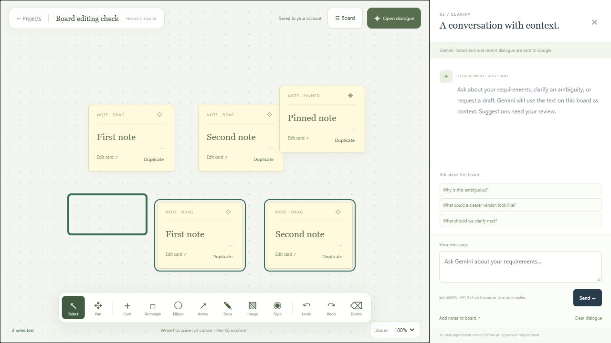
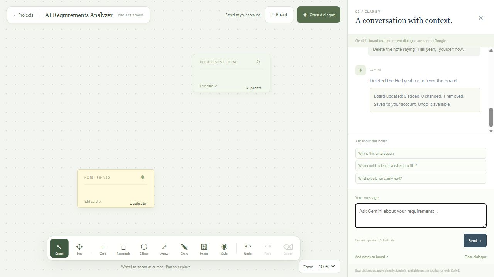

# Board workspace walkthrough

Open `/`, create an account or sign in, then select **New project** or open a project you own. Projects open directly on the board, with floating tools and a dialogue panel on the right.

The canvas fills the workspace beside dialogue. The main tools float at the bottom; Board actions float at the top. Close dialogue to expand the canvas further.

1. Open the Card menu in the floating toolbar. Add a requirement and a decision. Edit their contents; drag a card or use its header's arrow keys to move it.
2. Search for a word in a title or card body, then select a type filter. No matches shows an explicit empty state.
3. Duplicate a card. The copy retains text, gets a new identity and starts unpinned. Pin a card manually to lock its position; unpin to move it again.
4. Drag a selection box around two objects and move them together. Copy/paste with Ctrl+C/Ctrl+V. Delete the copies with Delete or the toolbar button; Ctrl+Z restores them, and Ctrl+Y redoes the deletion. Pinned objects stay locked. History is session-only and resets on refresh or project switching.
5. Check Saved to your account, refresh and reopen the project. Card text, positions, images and manual pins restore from the server database. A failed save shows a warning instead of claiming success. Create a second project to show its separate board.
6. Open dialogue and ask how to use the board or discuss project ideas. Ask for a note saying "Hell yeah"; watch it appear directly on the board. Ask Gemini to move/resize it, then delete it; use Undo to restore it. Add notes to board separately saves the discussion. It adds an unpinned draft only when requested. With GEMINI_API_KEY configured, replies come from Gemini using board text and recent dialogue; missing configuration shows a setup error.
7. Open Board → Ask Gemini to improve board. It adds useful requirements or clarification notes directly; Undo reverses the batch. Pinned objects stay locked.
8. Board → Export board to download JSON. Import board validates it and asks before replacing the current board. Export a backup before resetting sample data.

## What is real and what is simulated

Accounts, project creation, owner checks and per-project board persistence are implemented. The server uses SQLite; native startup creates data/analyzer.sqlite3, while Docker uses a persistent volume. Only the owner can list/open/save a project. Existing browser boards can be imported when creating a new project. Export JSON for a portable copy.

Dialogue and direct board actions call Gemini through the server when configured. Board text and recent dialogue go to Google on request; image pixels save with the project but are not sent to Gemini; file binaries are not parsed. Requested changes apply directly as one undoable batch; no confirmation buttons are shown. Dialogue is session-only. Review history remains illustrative. Project creation and account ownership are implemented; password recovery and team sharing are not included. See the application README for key/model setup.

File cards accept up to 1 MB; UTF-8 TXT/Markdown can provide text excerpts, while other formats store reference information only. Use `/prototype` for the separately implemented text/TXT validation and preview flow.

## Drawing and images

- Select Rectangle, Ellipse or Arrow, then drag on the canvas. Style sets color, stroke width and shape fill. Select Draw and drag to sketch. Each stroke is a separate object. Escape returns to Select.
- Select Image and choose a local PNG/JPEG/WebP/GIF (up to 12 MB). The board embeds a locally resized/re-encoded image; GIFs use one still frame.
- Drag an object's bottom-right handle to resize; Edit / resize also accepts exact dimensions. Object captions and drawing style can be changed in the editor.
- Select Pan to drag around the open-ended canvas. Zoom is in the lower-right corner. All visual objects are included in server saving and board JSON, subject to storage capacity and the 8 MB board limit.

Mouse-wheel navigation: point at the canvas and scroll up to zoom in or down to zoom out around that point (1–200%, without edge clamping). Scrollbars are hidden; use Pan to drag around the board. The percentage control also remains available. Use Board → Fit board to bring your objects back into view with space around the floating controls.

## Selection and editing shortcuts

Use Select and drag empty space for a selection box. Shift-click or Shift-drag adjusts the selection; dragging a selected object moves the unlocked objects as a group. Ctrl+A selects objects matching the current search/type filters. Arrow keys move the selection; Shift uses a larger step.

Copy selected objects with Ctrl+C and paste with Ctrl+V. Ctrl+Z undoes a board change, Ctrl+Y or Ctrl+Shift+Z redoes it, and Delete/Backspace deletes selected unlocked objects. Undo/Redo/Delete are also on the existing floating toolbar. Copy/Paste are in the Board menu. Inputs and dialogue keep normal text shortcuts.

## Direct board control from chat

Gemini receives the account-owned project name and description, board text, positions, dimensions, aspect ratios, selected IDs, viewport and nearby-object relationships. Ask it to add a note, edit an object, align or move a group, resize while preserving proportions, or delete selected objects. Changes apply directly and save to the project. Ctrl+Z reverses an entire AI reply's changes.

Pinned objects remain locked. Invalid batches or stale targets are rejected atomically. If you change the board or keep an editor open while Gemini is working, it does not overwrite that work. Image pixels and drawing paths are not sent to Gemini.

