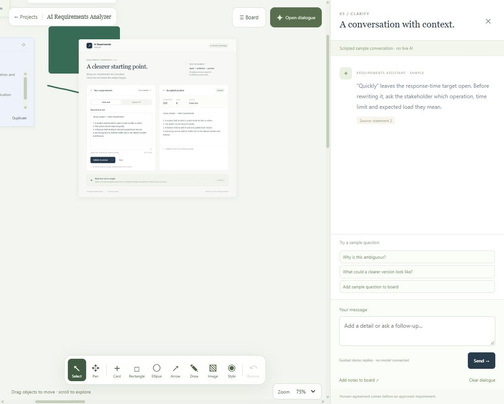

# Board workspace walkthrough

Open `/` and choose **AI Requirements Analyzer → Open workspace**. Projects open directly on the board, with floating tools and a dialogue panel on the right.

The canvas fills the workspace beside dialogue. The main tools float at the bottom; Board actions float at the top. Close dialogue to expand the canvas further.

1. Open the Card menu in the floating toolbar. Add a requirement and a decision. Edit their contents; drag a card or use its header's arrow keys to move it.
2. Search for a word in a title or card body, then select a type filter. No matches shows an explicit empty state.
3. Duplicate a card. The copy retains text, gets a new identity and starts unpinned. Pin a card manually to lock its position; unpin to move it again.
4. Delete a card and use Restore to restore it. Deletion undo is session-only and resets on import/reset.
5. Check the local save status, refresh and reopen the project. Card text, positions and manually chosen pins are restored in this browser. A storage failure shows a warning instead of claiming success.
6. Open dialogue, type a discussion note and click Add notes to board. It adds an unpinned draft only when requested. Replies are guided examples, not Gemini responses.
7. Open Board → Sample model proposal. Inspect the simulated proposal, then apply or discard. Pinned cards are protected; source text is not automatically rewritten.
8. Board → Export board to download JSON. Import board validates it and asks before replacing the current board. Export a backup before resetting sample data.

## What is real and what is simulated

The board's card controls, search, filters, duplication, deletion undo, browser saving and JSON export/import are implemented. Browser storage is local to the browser and site address; it is not cloud sync, a database or a guaranteed backup. Clearing browser data removes it. Export JSON for a portable copy.

Dialogue replies and model proposals remain simulated. Dialogue is session-only. Review history, project creation and project settings remain illustrative previews. There is no real AI call, account backend or server-side project saving.

File cards accept up to 1 MB; UTF-8 TXT/Markdown can provide text excerpts, while other formats store reference information only. Use `/prototype` for the separately implemented text/TXT validation and preview flow.

## Verification scope

The latest model suite has 21 passing checks. Browser evidence for the visual-board update is recorded below and in VERIFICATION.md. The walkthrough also includes controls verified in earlier increments.

## Drawing and images

- Select Rectangle, Ellipse or Arrow, then drag on the canvas. Style sets color, stroke width and shape fill. Select Draw and drag to sketch. Each stroke is a separate object. Escape returns to Select.
- Select Image and choose a local PNG/JPEG/WebP/GIF (up to 12 MB). The board embeds a locally resized/re-encoded image; GIFs use one still frame.
- Drag an object's bottom-right handle to resize; Edit / resize also accepts exact dimensions. Object captions and drawing style can be changed in the editor.
- Select Pan to drag around the open-ended canvas. Zoom is in the lower-right corner. All visual objects are included in browser saving and board JSON, subject to storage capacity and the 8 MB board limit.

Browser checks against the rebuilt Docker app verified the full-window layout, rectangle creation/style/resize, freehand drawing, local PNG upload, movement, zoom and persistence after refresh. Automated model checks also cover visual validation, duplication, resizing and file-size constraints. The temporary test server was unreachable; verification used the actual app at localhost:8000.

Mouse-wheel navigation: point at the canvas and scroll up to zoom in or down to zoom out around that point (1–200%, without edge clamping). Scrollbars are hidden; use Pan to drag around the board. The percentage control also remains available. Use Board → Fit board to bring your objects back into view with space around the floating controls.
